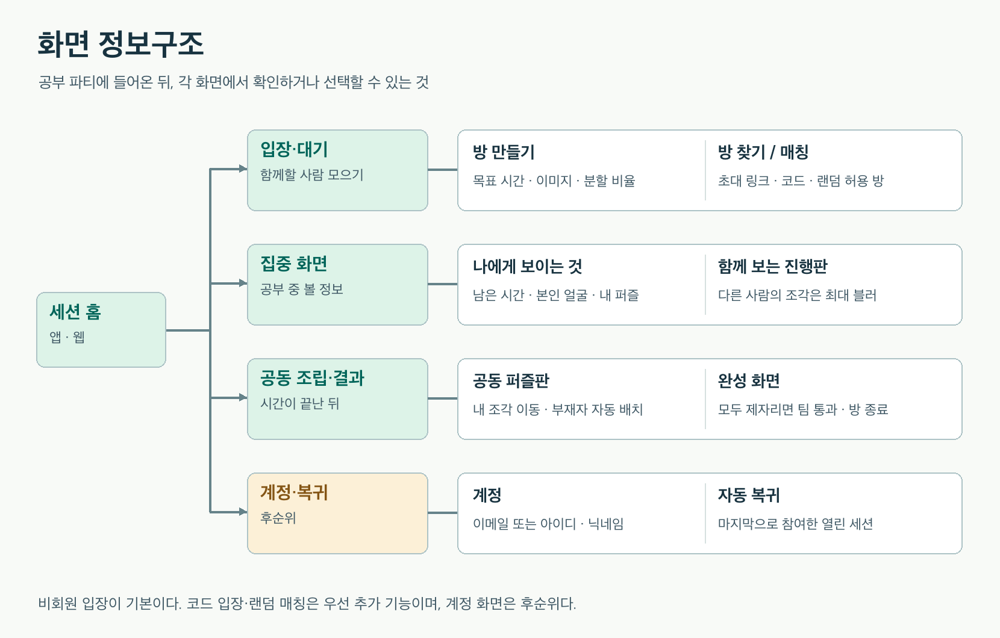
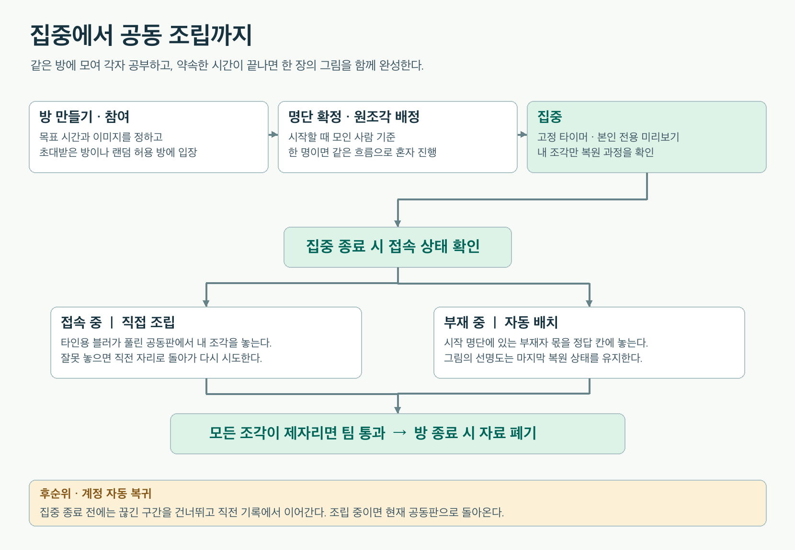

# 집중 세션 MVP — v0.12

Notion 원본의 조회 사본이다. MoSCoW·변경 기록 데이터베이스의 행은 표로 옮기고 두 토글의 이미지는 로컬 PNG로 연결했다. 이 사본의 저장은 개발 전달 완료나 기능 검증을 뜻하지 않는다.

---

문서 ID: MVP-TIME · 개정: v0.12 · 상태: **작업 중 초안 / 사용자 검증 전**

**프로젝트 제목**　미정. 팀에서 이름을 정하면 갱신한다.

집이나 독립된 공간에서 따로 공부하는 사람들이 시간을 약속하고, 각자 맡은 퍼즐을 복원해 마지막에 한 장의 그림을 함께 맞추는 서비스다. 행사 주제는 **권태 + 공부 × 덜어내기**다.

## 1. 대상과 문제

**핵심 대상**　집, 기숙사 1인실처럼 바로 옆에 함께 공부하는 사람이 없는 공간에서 스스로 한 과제를 이어가야 하는 학습자다. 같은 공간이라도 혼자 공부하는 편이 더 편하고 이탈이 문제라고 느끼지 않는 사람에게는 파티 참여의 필요성이 낮다.

**가설 페르소나 · 유진**　저녁에 자취방에서 전공 시험을 준비하는 대학생이다. 오늘 목표는 연습문제 세 개를 푸는 것이다. 두 번째 문제에서 막히자 풀이를 찾으려고 휴대폰을 켰다가 메시지와 짧은 영상을 차례로 연다. 타이머는 계속 흐르지만 방금 무엇을 하려 했는지 되짚어야 한다. 함께 끝낼 약속은 원하고, 얼굴이나 방 안을 다른 사람에게 보여주는 일은 부담스럽다. 팀이 설계한 가상 사례이며 실제 인터뷰로 확인할 예정이다.

**문제 정의**　팀은 하던 공부에 머물기 어려워 다음 자극으로 옮겨가고 싶은 순간을 ‘일시적 권태’라고 정의한다. 혼자 공부할 때 과제가 막히고 진척이 눈에 보이지 않으면, 다른 활동으로 옮기는 쪽이 쉬워진다는 것이 팀의 가설이다. 타이머는 남은 시간을 알려주지만, 흐트러진 순간에 같은 과제로 돌아올 이유까지 주지는 않는다.

**문제의 근거**　Rosen 등은 집에서 공부하는 중·고·대학생 263명을 15분간 관찰했다. 참여자들은 평균 6분이 지나기 전에 다른 활동으로 전환했고, 문자와 소셜미디어가 주요 방해 요인에 포함됐다. 가정 학습 중 이탈이 관찰된 사례다. 오늘날 국내 학습자의 발생률과 ‘고립이 권태를 일으킨다’는 인과는 팀이 별도로 확인해야 한다. [Rosen 등, 2013 · 원 연구](https://doi.org/10.1016/j.chb.2012.12.001)

## 2. 문제 해결 접근과 팀의 선택

**설계 가설**　공부 시간에는 화면에서 할 일을 덜어내고, 공부를 마친 뒤에는 함께 기다릴 결과를 하나 둔다. 공부 중 조각을 얻으려고 버튼을 누르거나 새 콘텐츠를 고를 필요가 없다. 팀과 약속한 한 장을 마무리하고 싶다는 마음이 딴짓으로 옮겨가려는 순간에 원래 과제를 이어갈 이유가 되는지 살핀다.

**파티를 선택한 근거**　온라인 스터디룸을 이용한 대학생 13명을 인터뷰한 연구에서 참가자들은 가까운 동료에 대한 책임감과 소속감이 공부를 지속하는 데 도움이 됐다고 설명했다. 일정 조율과 그룹 안에서의 산만함도 보고했다. 별도의 대학생 60명 읽기 실험에서는 ‘스터디 위드 미’ 영상 조건이 혼자 읽기보다 통계적으로 우수하지 않았다. 파티가 도움이 되는 상황과 오히려 방해되는 상황을 모두 검증한다. 두 연구는 각각 온라인 스터디 경험과 영상 동반 읽기를 다뤘고, 이 서비스의 퍼즐 효과는 아직 측정하지 않았다. [Lee 등, ECSCW 2025](https://doi.org/10.48340/ecscw2025_ep01) · [Ren 등, Computers & Education 2025](https://doi.org/10.1016/j.compedu.2025.105243)

**팀 회의에서 정한 해결책**　개설자가 공통 시간과 이미지를 정하면 시작 명단에 맞춰 원조각을 나눈다. 공부에 어떤 앱이나 책이 필요한지 서비스가 일괄 판단하기 어려워, 앱에서는 얼굴 미리보기를 본인에게만 띄워 스스로 상태를 확인하게 한다. 다른 참가자에게 얼굴을 보내거나 녹화하지 않는다. 데모에서는 집중 신호를 모의 값으로 처리한다.

집중 중에는 자기 조각만 복원도에 따라 선명해지고 다른 조각은 흐리게 보인다. 타이머가 끝나면 참가자별 마지막 복원 상태를 공개하고 한 판에서 각자 자기 조각을 맞춘다. 이때 눈에 보이는 것은 각자가 세션에서 남긴 복원 상태다. 실제 집중도·공부 시간·성적을 사람별로 측정한 값으로 해석할 수 없다. 모든 조각이 제자리에 놓이면 함께 통과한다.

**기획 기준**　문제와 원인·근거의 연결(논리성 20), 불편과 개선 효과 검증(문제 해결력 20), 적은 기능으로 한 과업 완주(기능 최적화 30), 화면과 다음 행동의 연결(화면 최적화 20), 회의 결정과 시연의 일관성(팀워크 및 완성도 10)을 따른다. 연구와 심사 기준 확인일은 2026년 11월 21일이다. [공식 PM 심사 기준](https://cmc-11th-hackathon.vercel.app/criteria)

## 3. MVP 범위 · MoSCoW

Must만으로 비회원이 파티에 모여 공부하고 한 장을 완성할 수 있다. Should는 파티에 들어가는 선택지를 늘린다. Could는 계정이 필요한 후순위 기능과 아직 채택하지 않은 후보이며, Won’t는 이번 데모에서 제공하지 않는 기능이다. 기능별 완료 기준은 시연 전에 확인할 항목이다.

### [Must have · 핵심 과업](https://app.notion.com/p/41fc0efa070a814ba13dde88f9b69c5d)

| 기능 | 기능 ID | 선정 이유 | 완료 기준 | 비고 |
| --- | --- | --- | --- | --- |
| [파티 개설·비회원 입장](https://app.notion.com/p/41fc0efa070a8147a5b4c19f17c5fb8c) | F-001 · F-002 · F-007 | 혼자 있는 자리에서도 같은 시간에 공부를 시작할 동료를 모은다. | 목표 시간·이미지·분할 비율을 정해 링크로 모인다. 시작할 때 명단을 고정하고 혼자면 같은 입구에서 바로 시작한다. | 시작 후 신규 입장은 닫는다. 한 명이면 자신의 이미지 전체를 맡는다. |
| [한 번 정한 집중 시간](https://app.notion.com/p/41fc0efa070a816b8fbdf6944b836606) | F-003 · F-005 | 얼마나 더 할지 반복해서 결정하는 부담을 덜어낸다. | 공통 종료 시각까지 타이머가 흐른다. 한 사람의 연결이 끊겨도 다른 참가자의 시계는 계속 간다. | 20분 방에서 8분에 끊기면 그 사람의 개인 복원도만 고정되고 방에는 12분이 남는다. |
| [본인 전용 얼굴 미리보기](https://app.notion.com/p/41fc0efa070a813f8acbe70a5550eb33) | F-004 | 공부 중 스스로 자세와 상태를 돌아볼 단서를 제공한다. | 앱에서 카메라를 허용하면 자기 화면에만 얼굴이 보인다. 데모는 집중 상태의 변화를 모의 값으로 보여준다. | 얼굴 영상 저장·전송 없음. 웹은 세션 실행을 지원하며 웹 카메라와 권한 거부 시 처리 방식은 Q-002. |
| [공동 조립·팀 통과](https://app.notion.com/p/41fc0efa070a81a7b9eaf2ca338b2e5f) | F-006 · F-007 · F-009 | 혼자 한 공부를 팀이 함께 끝낼 수 있는 한 가지 과업으로 연결한다. | 조립 시작 시 소유자별 최종 복원 모습이 모두에게 보인다. 자기 조각만 옮기고 오배치는 직전 자리에서 재시도한다. 전부 제자리면 통과한다. | 집중 종료 시 부재한 사람 몫은 마지막 선명도로 정답 칸에 자동 배치한다. 혼자면 자기 조각으로 완성한다. |
| [세션 종료와 자료 폐기](https://app.notion.com/p/41fc0efa070a81e3a878d19c640e64e0) | F-006 · POL-010 | 사진이나 활동 이력을 남기는 부담 없이 한 회차를 마친다. | 방이 종료되면 사진·조각·공동판·결과·임시 식별자를 폐기하고 이전 링크로 결과를 열 수 없다. | 집중 타이머가 만료되면 먼저 조립으로 이동한다. 방 종료와 구분한다. |
| [퍼즐 배정과 복원](https://app.notion.com/p/41fc0efa070a816b99e6c3ed20adb2d8) | F-008 · F-009 | 정한 시간에 머문 흔적을 한 장의 그림에 남겨 함께 마칠 이유를 만든다. | 기본 이미지나 업로드 사진을 명단대로 자동 분할한다. 내 조각은 복원도대로, 남의 조각은 집중 종료까지 최대 블러로 보인다. | 개설 시 1/4를 선택하고 원조각이 6개라면 조립 조각은 한 영역당 4개, 전체 24개다. |

### [Should have · 우선 추가 기능](https://app.notion.com/p/41fc0efa070a8174916ed9c5c340a5c5)

| 기능 | 기능 ID | 선정 이유 | 완료 기준 | 비고 |
| --- | --- | --- | --- | --- |
| [코드로 방 찾기](https://app.notion.com/p/41fc0efa070a81078fffcafa18f1948f) | F-011 | 이미 함께할 사람이 있을 때 로그인이나 링크 찾기 없이 합류한다. | 비회원이 유효한 코드를 입력하면 해당 대기방에 한 번만 입장한다. | 랜덤 허용을 끈 방도 가능하다. 잘못된 코드·시작·종료·만석 안내, 코드 복사와 유효기간을 다룬다. |
| [랜덤 허용 방 매칭](https://app.notion.com/p/41fc0efa070a810ea93fcb02ff7bf89b) | F-012 | 초대할 사람이 없는 학습자도 공부 파티에 합류한다. | 비회원 요청을 랜덤 참가를 허용한 기존 대기방 한 곳의 빈자리에 무작위로 배정한다. | 매칭 조건은 개설자의 허용 여부 하나다. 시작 전·빈자리는 공통 입장 규칙이다. 대상 없음·대기 취소·중복 요청을 처리한다. |

### [Could have · 여유 시 검토](https://app.notion.com/p/41fc0efa070a81f594dbca0c4f58030b)

| 기능 | 기능 ID | 선정 이유 | 완료 기준 | 비고 |
| --- | --- | --- | --- | --- |
| [개설 전 이미지 필터](https://app.notion.com/p/41fc0efa070a8165af8df9e6a36a6157) | F-001 · F-008 | 파티가 완성할 그림의 모양을 정할 수 있다. | 채택하면 개설자가 미리 본 필터 이미지를 분할·복원·조립에 동일하게 사용한다. | 팀 검토 후보. 구현 채택과 필터 종류는 미정이다. |
| [계정 가입·로그인](https://app.notion.com/p/41fc0efa070a81c8af77e285cbce4cf6) | F-010 | 계정으로 이전 세션을 식별할 필요가 생길 때 제공한다. | 이메일 또는 아이디와 비밀번호로 인증하고 닉네임을 사용한다. | 로그인 관련 기능은 모두 후순위. 닉네임 중복·인증 만료·비밀번호 재설정·탈퇴 방식은 미정이다. |
| [마지막 세션 자동 복귀](https://app.notion.com/p/41fc0efa070a819dadf6eaea29fe2ee1) | F-013 | 앱이나 웹이 닫혀도 기존 참가자가 맡았던 작업을 이어간다. | 같은 계정이면 아직 열린 마지막 세션으로 자동 이동한다. 집중 종료 전이면 직전 기록에서 이어간다. | F-010에 의존한다. 20분 방에서 8분에 끊겨 11분에 돌아오면 개인 기록은 8분 시점, 남은 시간은 9분이다. 종료 때 부재했다면 자동 배치된 현재 공동판을 본다. |

### [Won’t have · 이번 데모 제외](https://app.notion.com/p/41fc0efa070a81c391e8e9098bbaef4c)

| 기능 | 기능 ID | 선정 이유 | 완료 기준 | 비고 |
| --- | --- | --- | --- | --- |
| [실제 집중도 판정·앱 사용 감시](https://app.notion.com/p/41fc0efa070a81e1bbf1f741cc7ee371) | F-004 · POL-001 · POL-012 | 얼굴의 유무나 화면 체류만으로 공부 내용을 판정할 수 없다. | 이번 데모에서는 다른 앱 사용 이력·시선·학습 점수를 수집하거나 표시하지 않는다. | 집중 표시와 퍼즐 품질은 데모 신호로 설명한다. |
| [얼굴 공유·사진과 결과 영구 보관](https://app.notion.com/p/41fc0efa070a81e08bebd0775f76aafc) | F-006 · POL-010 · POL-012 | 집중 세션 밖까지 참여자의 영상이나 학습 이력을 남기지 않는다. | 다른 사람의 카메라 화면, 결과 보관함과 종료된 세션의 사진 재조회는 제공하지 않는다. | 계정 기능을 추가해도 방 종료 시 자료 폐기 원칙을 적용한다. |

## 4. 정보구조와 사용자 흐름

화면 정보구조 · IA

사용자 흐름 · 공동 조립

## 5. 검증할 장면

| 확인할 상황 | 기대하는 결과 |
| --- | --- |
| 개설자가 세션 생성 시 1/4 설정 | 공동 조립에서 해당 원조각 한 개당 4개가 생성되며 참가자가 비율을 다시 선택할 필요가 없음 |
| 시작 뒤 신규 입장·일부 연결 끊김 | 신규 입장을 닫고 단절된 참가자의 복원 상태를 고정하며 공통 타이머는 계속 진행 |
| 집중 종료 시 A가 부재하고 B가 접속 중 | A의 마지막 복원 모습으로 A 몫만 자동 배치. B가 자기 몫을 맞춰 전체가 제자리면 팀 통과 |
| 기본·업로드 이미지 | 자동 분할된 조각이 맞물리고 전부 복원하면 틈이나 겹침 없이 원본이 보임 |
| 공동 조립 중 A와 B가 서로 다른 조각을 놓음 | 두 화면에 같은 두 배치가 보이고 조각을 옮겨도 드러나는 이미지 정보가 늘어나지 않음 |
| A가 B의 조각을 옮기려 할 때 | 조각은 제자리에 있고 어느 팀원의 판에도 변경이 반영되지 않음 |
| 마지막 한 조각을 잘못 놓은 뒤 다시 제자리에 놓음 | 잘못 놓은 조각만 직전 위치로 돌아가고 조립은 계속됨. 소유자가 다시 놓아 전부 제자리면 팀 통과. 복원도는 판정에 영향을 주지 않음 |
| A가 30%, B가 80% 복원했을 때 | 집중 중에는 서로의 조각에 최대 블러 적용. 조립 시작 후 두 사람 모두 A 원조각은 30%, B 원조각은 80%까지 복원된 모습으로 봄 |

**효과 검증안 · 미실행**　집에서 혼자 공부하는 참가자가 비슷한 난이도의 과제를 정해 같은 길이의 두 세션을 진행한다. 한 번은 개인 타이머, 한 번은 파티 퍼즐을 사용하며 순서를 번갈아 배정한다. 종료 직후 딴짓으로 전환한 횟수(자가보고), 처음 정한 과제의 완료 여부, 퍼즐을 확인하느라 새로 생긴 이탈을 각각 묻는다. 카메라나 조각의 선명도로 집중 시간을 추정하지 않는다.

딴짓 횟수가 줄고 과제 완료가 유지되면 가설을 지지하는 신호로 본다. 퍼즐 확인 때문에 이탈이 늘면 공부 중 보이는 정보를 줄이는 방향을 재검토한다. 세션을 중간에 마치거나 본인이 횟수를 떠올리지 못하면 판단을 보류한다. 팀 자체 인터뷰·비교 실험·기능 검증 결과는 아직 없다.

## 6. 결정 현황

| ID | 정한 내용 | 남은 선택 |
| --- | --- | --- |
| Q-001 | 같은 입구에서 1인·공동 시작 | 없음 |
| Q-002 | 앱 중심, 웹 실행 지원 | 웹 카메라 지원 범위, 권한 거부·미지원 시 참여와 복원 처리 |
| Q-003 | 시작 후 신규 참가 제외, 단절 중 복원도 고정, 집중 종료 전 계정 복귀 시 이어서 진행, 종료 시 부재자 몫 자동 배치 | 단절 확정 시점, 조기 종료 권한, 결과 표시와 방 폐기 사이의 경계 |
| Q-004 | 세션 종료 시 사진·결과와 임시 데이터 전부 폐기 | 비정상 종료·방치된 방도 정리할 조건 |
| Q-005 | 공부 범위나 앱·사이트 이용 내역을 판정하지 않음 | 결과 화면에서 참가자 이름을 표시할지 |
| Q-006 | 공통 목표는 시작 후 고정 | 목표 범위·최대 인원·파일 한도·시간 오차 |
| Q-007 | 세션 생성 시 개설자가 분할 비율 설정. 공동판에서는 자기 조각만 이동. 오배치 시 직전 위치에서 재시도하고 전체 조각이 제자리면 팀 통과 | 제공할 분할 비율·필터 채택 여부 |
| Q-008 | 집중 중 타인 조각 최대 블러. 조립 시작 시 이를 해제하고 소유자의 최종 복원 상태만 모두에게 공개 | 데모의 모의 상태를 내 원조각 복원 속도에 반영하는 방식 |

## 변경 기록

### [MVP 변경 기록](https://app.notion.com/p/41fc0efa070a810c9912ccd4f2a4ea12)

| 버전 | 변경 내용 | 문서 상태 |
| --- | --- | --- |
| [v0.12](https://app.notion.com/p/41fc0efa070a814191ecf385cc896e22) | 집에서 혼자 공부하는 사람의 문제·페르소나·연구 근거·검증안을 정리했다. 기능 범위를 MoSCoW 네 표로 구성하고 IA·흐름을 그림으로 교체했다. 예시는 기능 비고에 통합하고 작업 순서·행사 제약 절을 삭제했다. | 작업 중 초안 |
| [v0.11](https://app.notion.com/p/41fc0efa070a811a9a8ff66b06139a37) | 로그인 관련 기능을 후순위로 정하고 랜덤 허용 방의 비회원 매칭, 마지막 세션 자동 복귀, 부재자 조각의 자동 완성을 반영했다. | 이전 개정 |
| [v0.10](https://app.notion.com/p/41fc0efa070a812c9d2bda2bb1c8e9ba) | 계정·코드 입장·랜덤 매칭·계정 복귀를 추가 기능으로 기록했다. | 이전 개정 |
| [v0.9](https://app.notion.com/p/41fc0efa070a810ea218d52640042bdc) | 잘못 놓은 조각을 드래그 직전 위치로 되돌리고 소유자가 즉시 다시 시도하도록 정했다. | 이전 개정 |
| [v0.8](https://app.notion.com/p/41fc0efa070a8147b3bcc6baab933e0d) | 조립 조각의 소유자만 이동할 수 있고 모든 조각이 정답 위치에 있어야 팀이 통과하도록 정했다. 오배치의 화면 반응은 미정으로 남겼다. | 이전 개정 |
| [v0.7](https://app.notion.com/p/41fc0efa070a81fc95b0d08debc2c8f6) | 세션 생성 시 개설자가 분할 비율을 정하고, 공동 조립 시작 시 소유자의 최종 복원 상태를 모두에게 보여주는 규칙을 확정했다. | 이전 개정 |
| [v0.6](https://app.notion.com/p/41fc0efa070a8126a63cc7af34bd7830) | 세션 생성 전 이미지 필터 후보, 공부 중 타인 조각의 최대 블러, 원조각별 재분할과 공동 조립안을 반영했다. | 이전 개정 |
| [v0.5](https://app.notion.com/p/41fc0efa070a816b8860fcc18475052e) | 데모의 얼굴 미리보기와 모의 감지를 구분하고, 1인·다인 모두 전체 퍼즐을 개인판에서 조립해 각자의 이미지로 마무리하는 흐름으로 개정했다. | 이전 개정 |
| [v0.4](https://app.notion.com/p/41fc0efa070a813fa263c73bccdbb8c3) | 자동 퍼즐 분할, 앱 중심·웹 실행, 본인 전용 카메라, 진행 중 전체판과 만료 후 위치 맞히기를 반영했다. | 이전 개정 |
| [v0.3](https://app.notion.com/p/41fc0efa070a81cc9cd0c6bbab80cfa5) | 공통 타이머, 단절 시 고정, 기본·직접 분할 이미지, 절단면 복원과 종료 시 폐기를 반영했다. 집중 확인은 미정이다. | 이전 개정 |
| [v0.2](https://app.notion.com/p/41fc0efa070a81618683fcac5bf89793) | 기존 무작위 위치 채움 안을 개설자 이미지의 부위별 크기 성장으로 개정했다. 로그인 없는 시간 기록과 본인 구간 조회는 v0.1의 흐름을 이어 쓴다. | 이전 개정 |
| [v0.1](https://app.notion.com/p/41fc0efa070a81d58ce7db6886e3fa84) | 로그인 없는 시간 기록과 본인 구간 조회를 초기 흐름으로 삼았다. v0.2 변경 기록에서 확인한 범위. | 이전 개정 |

## 연결 문서

- [집중 세션 기능명세 — v0.11](https://app.notion.com/p/41fc0efa070a812e9017ee2892491213)
- [집중 세션 정책서 — v0.11](https://app.notion.com/p/41fc0efa070a816ba3a0c1719aa63984)
- [Nerdinary-Hackathon-5Team](https://app.notion.com/p/41fc0efa070a80aeb91fe456673f9d3b)

원본은 Notion이다. 로컬 사본은 저장된 원본을 조회한 뒤 갱신한다. 기술 스택·개인별 배정·개발 전달 완료는 이 문서 작성으로 자동 확정되지 않는다.
